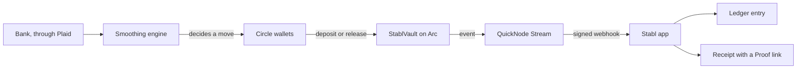

# Stabl

**Steady pay for uneven income.** Stabl sets money aside in good weeks and gives it back in slow ones. In this version the vault that holds that money is a smart contract on Arc, and the person using it never has to know.

- **Live app:** https://stabl-crypto.vercel.app
- **Vault contract (Arc Testnet, verified):** [`0xD70f1e4973458D2b2E440b17600c53A4ca78d90f`](https://explorer.testnet.arc.io/address/0xD70f1e4973458D2b2E440b17600c53A4ca78d90f)
- **Built for:** University Blockchain Conference 2026 hackathon. Consumer Applications track, built on Arc, using QuickNode Streams.

## The problem

Stabl starts with freelancers who earn enough over a year but get paid at unpredictable times. Their bills arrive on fixed dates; their income does not. A good month gets spent, and a slow month means overdrafts and payday loans.

Uneven income is common, and well documented:

- A typical family's income changes by about **36% from one month to the next** ([JPMorgan Chase Institute, *Weathering Volatility 2.0*](https://www.jpmorganchase.com/institute/all-topics/financial-health-wealth-creation/report-weathering-volatility-2-a-monthly-stress-test-to-guide-saving)).
- Households in the U.S. Financial Diaries spent **about five months a year** with income more than 25% above or below their average ([Financial Health Network, U.S. Financial Diaries](https://finhealthnetwork.org/u-s-financial-diaries/)).
- **85% of freelancers** say they are paid late at least some of the time ([Remote](https://remote.com/blog/contractor-management/reversing-late-payment-culture)).
- As Jonathan Morduch, co-author of *The Financial Diaries*, put it, families "want to have the right money at the right time" ([Dawn](https://www.dawn.com/news/1327369)).

Stabl spreads money a person already earns across time. It cannot help someone whose income stays below their spending, and it tells them so instead of moving anything.

Stabl connects to a person's bank, learns their income pattern and their bills, and then does two things:

- **In a good stretch** it moves the surplus into a locked vault, after telling them a day ahead.
- **In a slow week** it sends money back to checking, right away.

Every move gets a plain message. There is nothing to configure and nothing to remember.

## Why put the vault on a blockchain

A product that moves your money on its own has one question to answer: what stops it from moving your money somewhere else?

For most apps the answer is "trust us," and that has failed before. In 2024 the fintech middleman Synapse collapsed. It kept the ledger of who was owed what; when it failed, customers could not prove their balances, and the bankruptcy trustee found a gap of tens of millions of dollars between what customers were owed and what partner banks held ([NBC News](https://www.nbcnews.com/business/business-news/synapse-bankruptcy-trustee-says-85-million-customer-savings-missing-fi-rcna156108), [American Banker](https://www.americanbanker.com/news/cfpb-to-hold-synapse-responsible-for-missing-customer-funds)). With Stabl, every vault balance sits on a public ledger anyone can check.

Here much of the answer is a contract anyone can read. The vault holds each person's money as USDC, and the contract enforces these rules whatever Stabl's servers ask for:

1. **Closed loop.** Every way out of a vault pays that vault's owner. No function sends an owner's money to any other address.
2. **A limited operator.** Stabl can add money to a vault and send it back to its owner. It cannot redirect, borrow or sweep anything.
3. **Freeze.** An owner can freeze their vault. Nothing moves in or out until they unfreeze it. Stabl can freeze on someone's behalf, because stopping is always safe, but can never unfreeze.
4. **Emergency unlock.** The owner's own wallet can take money out without the operator. The only place it can go is that wallet.
5. **Once only.** Every move carries the app's move id. A move settles once, so a retried request never moves money twice.

There is no admin key, no pause switch, no fee and no upgrade path. The contract is about 150 lines: [contracts/src/StablVault.sol](contracts/src/StablVault.sol).

The person using Stabl sees none of this. They see dollars, their bank, and a small **Proof** link on each receipt.

**Who holds the key.** Every vault starts with a Circle developer-controlled wallet, so a new person can use Stabl without ever seeing a wallet. Stabl signs for that wallet, which means the contract limits where money can go, but on its own it is not an exit that works if Stabl disappears. So each person can move their vault to **a key on their own device**: a Circle modular wallet whose only signer is a passkey (Face ID or a fingerprint). After that, only they can unfreeze the vault or unlock money from it. See [Hold your own key](#hold-your-own-key-passkey-wallets).

## Why these choices

**Why a contract vault, not a savings account at a bank.** A bank account's rules are the bank's policy, its ledger is private, and transfers often wait for business days. Stabl's vault rules are code anyone can read, the record is a public ledger anyone can check, and it settles around the clock. Holding USDC also means the vault can later earn yield or move across chains without a new banking partner.

**Why Arc, not another chain.**
- **Fees in dollars.** Arc's gas token is USDC, the same asset the vault holds. Fees are smoothed to stay steady, about a tenth of a cent for a transfer ([Arc stable fee design](https://docs.arc.io/arc/concepts/stable-fee-design.md)). A consumer app that only speaks dollars never has to buy or explain a second token.
- **Final in under a second, and never reversed.** Arc's BFT consensus gives deterministic finality: no confirmation windows and no reorganizations ([Arc deterministic finality](https://docs.arc.io/arc/concepts/deterministic-finality.md)). That is why Stabl can settle a move on a single event, and why its Stream needs no reorg handling.
- **Built for USDC.** Circle's wallets, Gas Station, CCTP and App Kits (on-ramp, earn) work on Arc first. The simulated dollar to USDC step has a real path to replace it.

**Why Circle wallets, not MetaMask or our own keys.** Every person gets a wallet without a seed phrase or an install. Gas Station sponsors every fee, so nobody needs crypto. Stabl's servers never hold a private key: Circle signs, and every request carries an idempotency key so a retry cannot double-spend. And when a person wants to hold the key themselves, Circle's modular wallets put it in a passkey on their device, with Circle's paymaster still covering the fee.

**Why QuickNode Streams, not polling or websockets.**
- **Push, not poll.** Polling Arc every few seconds for every person wastes calls and still lags. A Stream posts each event the moment its block is processed.
- **Fits a serverless app.** Stabl runs on Vercel, which cannot hold a websocket open. A Stream delivers to a plain webhook.
- **Nothing missed.** A Stream processes blocks in order and does not move on until the webhook accepts a delivery; it retries otherwise. Stabl stores each event once, so a retry never counts twice.
- **Only what matters, signed.** The filter runs on QuickNode's side and passes only the vault's logs; each delivery carries an HMAC signature.
- **The chain is the source of truth.** Circle reports what it signed; the Stream reports what the contract actually did. Stabl settles on the contract's event.

**How a release reaches the bank in minutes.** Arc settles a vault move in under a second, but getting dollars into a checking account depends on the bank: seconds over FedNow or RTP if the bank supports them, about 30 minutes pushed to a debit card, the same day by wire, or one to three business days by ACH. Circle Mint redemptions typically settle the next business day ([Circle Mint docs](https://developers.circle.com/circle-mint/concepts/how-minting-works)). So in production, Stabl would not make a person wait on that:

1. The contract releases the USDC. It is final in under a second, on any day.
2. At the same moment, Stabl sends the dollars from a small cash reserve at a partner bank over FedNow, RTP or a push to the person's debit card.
3. Stabl redeems the released USDC to refill the reserve. That can take a business day without the person noticing.

Arc is what makes paying first safe. By the time Stabl sends the dollars, the matching USDC has already left the vault for good: it cannot bounce or be reversed, so the reserve can stay small. Set-asides do not need this, because they are announced a day ahead and can travel by ordinary ACH. And because the engine sees bills coming, it can release a day or two early whenever an instant rail is not available. None of this is built yet; the bank side is simulated in this version.

**The trade-offs.**
- **Custody.** A vault starts with a Stabl-managed wallet, which Stabl signs for. A person can switch to a passkey wallet that only they can sign for; it is opt-in, and the presenter account keeps the Stabl-managed one. Passkey recovery, if a person loses their device, is not set up yet.
- **Privacy.** A public ledger shows vault balances. No names or bank details go on chain, only wallet addresses, but balances are visible. Arc's opt-in privacy is on its roadmap and not yet available ([Arc opt-in privacy](https://docs.arc.io/arc/concepts/opt-in-privacy.md)).
- **Cost of the Stream.** Streams bill for every block processed, and Arc is fast, so it is switched off when idle; the fallback that reads Arc directly covers the gap.

## How it works



1. **Plaid** reads the person's accounts. Stabl never moves money at the bank in this build, so it is safe to check out the app.
2. **The engine** ([engine/](engine/)) is pure functions. It learns income and bills, then decides when to set aside and when to give back.
3. **Circle wallets** own each vault on chain. A new person gets a hidden developer-controlled smart account, and can switch to a passkey wallet that only their device can sign for. Circle's Gas Station and paymaster cover the fees either way, so no one needs crypto. Stabl's servers hold no private keys.
4. **StablVault on Arc** holds the USDC and enforces the rules above.
5. **A QuickNode Stream** watches the contract and posts each of its events to the app.
6. **The app settles the move only then.** The ledger entry and the receipt are written when Arc says the money moved, not when the app asked for it.

### Arc

- USDC is Arc's native asset, so the vault holds the same thing fees are paid in. There is no second token to manage.
- Transactions are final in under a second, so "sent back to checking, right away" is true on chain too.
- The contract uses USDC's ERC-20 interface (6 decimals) and never touches native value directly: no payable function, no `receive`, no `SELFDESTRUCT`. See [contracts/README.md](contracts/README.md).
- It was deployed from a Circle smart contract account through Arc's CREATE2 factory, so the deploy itself was fee-sponsored and involved no private key.

### QuickNode Streams

The Stream is what turns a transaction into a receipt.

- **Setup:** one `logs` stream on `arc-testnet`, created by [scripts/chain-stream.ts](scripts/chain-stream.ts).
- **Filter:** runs on QuickNode's side and passes only the vault contract's logs ([lib/chain/stream.ts](lib/chain/stream.ts)). Blocks with nothing from the vault produce no delivery.
- **Destination:** a webhook, [app/api/chain/stream/route.ts](app/api/chain/stream/route.ts). Every delivery is checked against the stream's HMAC signature and a ten minute freshness window.
- **Exactly once:** each event is stored under a unique (transaction, log index) key before anything else happens, so a repeated delivery does nothing.
- **Fallback:** if an event has not arrived a few seconds after a move was sent, the app asks Circle for the transaction and reads its receipt from Arc directly. Whichever source is first settles the move, and each move records which one it was (`confirmed_by`). This also covers local development, where there is no public address for a webhook.

Streams bill for every block they process, and Arc makes a block about every 0.7 seconds. The script can delete and recreate the stream, so it only runs when the app is in use.

**Backfill.** A second Stream replays the vault's whole history: the same network, dataset and filter, with a fixed range from the block the contract was deployed in (72518444) up to the moment it is created. It delivers to [app/api/chain/backfill/route.ts](app/api/chain/backfill/route.ts), which runs every event through the same exactly-once path as the live Stream. So the replay:

- records any event Stabl missed, for example while the app was down or the live Stream was switched off,
- settles any move still waiting on its event,
- and changes nothing already recorded: every event it has seen before comes back as a duplicate.

On November 16 the backfill replayed 111,894 blocks in about six minutes. It found 8 vault events the live site had never recorded (made by test runs outside it), recorded them, and left the 25 events the live Stream had already delivered untouched. The app's balances still matched the contract afterwards, and no move was left waiting.

Afterwards `npx tsx scripts/live-check.ts` compares each vault's balance in the app with the contract's, and counts events by the source that first recorded them (`stream`, `backfill` or `reconcile`). Run it with `npm run chain:stream -- backfill`, and watch it with `npm run chain:stream -- backfill-status`.

## Does it help?

A simulation, not a study: [docs/simulation.md](docs/simulation.md). 200 synthetic freelancers, none of them the app's presenter personas, run for six months through the real engine, each one with Stabl and without it on the identical bank feed.

- **Stabl never made things worse.** With spending held fixed, it caused 0 extra overdraft days across 180 people who earn more than they spend, and 0 across 20 who do not.
- **The benefit depends on how much visible money gets spent.** If a person spends 10% of any spare checking each week, overdraft days fall from 879 to 777. At 20% they fall from 1,556 to 987, and at 30% from 2,175 to 1,228. Nobody ended up worse off at any rate.
- **What it cannot show:** whether real people spend that way, or whether they would allow automatic transfers. That needs real users.

## See it on Arc

These are real transactions from the live site.

| In the app | On Arc |
| --- | --- |
| "Moved $650.00 to your vault." | [Deposited, 0.65 USDC](https://explorer.testnet.arc.io/tx/0xfcbf2fcad4711208687b122a4f1b01a6c59bf5cf99df73c45eb2060ba391a2f1) |
| "Slow week, so we sent $210.00 from your vault to Checking 4321." | [Released, 0.21 USDC](https://explorer.testnet.arc.io/tx/0x8a51a26643c1e21f7e56f584fc8cfb548186a51759f6e9e972eeb2556f24ab18) |
| "Emergency unlock done. We sent $150.00 from your vault to Checking 4321." | [EmergencyUnlocked, 0.15 USDC](https://explorer.testnet.arc.io/tx/0x2014fc95f62811642101efb17766aaaed2d1f8c2c3c2a49651474ffb5c1f3a4d), sent by the owner's wallet, not the operator |
| A vault frozen, then unfrozen, by its owner's wallet | [Frozen](https://explorer.testnet.arc.io/tx/0xeedff541e643dae3558d229cb056730727e6ad42a19a52a7e6f081d2bd3b1a8a) and [Unfrozen](https://explorer.testnet.arc.io/tx/0xef4f5c7b73059e1bdbe889ec1ba51b468b9af2033ce2408ff57a5a69b89f0558) |
| The contract being deployed | [Deploy](https://explorer.testnet.arc.io/tx/0x1302c8f4725d73f795a258edca6dbf6fd74c3ae4363d0cda55f165baff91cd3d) |

The QuickNode Stream confirmed all three moves to the app: each move records `confirmed_by = stream`. From the app sending each transaction to the webhook settling it took 2.1 seconds for the deposit, 4.7 for the release, and 8.7 for the emergency unlock, which includes the person entering their code. After each one the app's balance and the contract's matched.

## Hold your own key: passkey wallets

A vault can belong to a **Circle modular smart account whose only signer is a passkey** on the person's device ([lib/chain/passkey.ts](lib/chain/passkey.ts), [lib/passkey-client.ts](lib/passkey-client.ts)). Stabl cannot sign for it.

**Moving a vault to a passkey**, from the Vault screen:
1. The browser creates the passkey and the smart account it signs for.
2. That account signs a one-time challenge from Stabl; Stabl verifies the signature on Arc (ERC-6492, so it works before the account is deployed).
3. Stabl moves the balance on chain in three transactions: the operator releases it to the old wallet, the old wallet hands the USDC back, and the operator deposits it for the new owner. The app's ledger does not change, because it is the same person's money throughout.

**What changes after that**

| | Stabl-managed key | Passkey on your device |
| --- | --- | --- |
| Set-asides and releases | Automatic | Automatic: the contract lets Stabl's operator do these, but only ever back to you |
| Freeze | Any channel, at once | Same: Stabl's operator freezes on your behalf, which the contract allows |
| Unfreeze | Code | Code, then your passkey. Stabl cannot unfreeze on its own |
| Emergency unlock | Code | Code, then your passkey signs it. Stabl never sends it |
| Released money | Sent back to Stabl's operator, standing in for your bank | Stays in your own wallet |

For a passkey-signed move, the server hands the browser the transaction, the browser sends it with Circle's paymaster covering the fee, and the server reads the result from Arc before applying it ([app/api/vault/signed/route.ts](app/api/vault/signed/route.ts)). It never trusts the browser's report alone. From Telegram, UNFREEZE points the person to the app.

**How it was tested**
- With a real passkey on the live site: linking, then a freeze sent by Stabl's operator on the owner's behalf ([Frozen](https://explorer.testnet.arc.io/tx/0xc6980ce504d3be6f241920201b3ab952ccfbebc196951af832d96e3a2263476d)), then an unfreeze signed by the passkey and sent through Circle's bundler with the paymaster covering the fee ([Unfrozen](https://explorer.testnet.arc.io/tx/0x655acbbd3abdf12e3375619904d5bbb1927da85b9c8285ba75f8714bee6afe98), a user operation through the ERC-4337 EntryPoint).
- Moving a funded vault, an owner-signed emergency unlock, and freeze and unfreeze, all on Arc, with an ordinary key standing in for the passkey: [scripts/try-passkey-server.ts](scripts/try-passkey-server.ts) and [scripts/try-passkey-freeze.ts](scripts/try-passkey-freeze.ts). In those runs a $2,550.75 vault moved to its new owner in about 11 seconds, Stabl's own attempt to unfreeze left the contract frozen, and the owner's signed unlock settled in under 3 seconds with the app and contract in agreement.

**Not done yet:** passkey recovery, so a person who loses their device can restore access ([Circle's guide](https://developers.circle.com/wallets/modular/set-up-passkey-recovery.md)).

## Try it

Open https://stabl-crypto.vercel.app and sign in with any email address.

1. Answer two questions about how you earn, agree to the rules, and give a name and date of birth.
2. **Connect a bank.** This opens Plaid's real window in test mode. Pick any bank and use Plaid's test login: username `user_good`, password `pass_good`.
3. Choose your home base, review what Stabl learned, and open your vault.
4. Stabl runs its first check straight away and tells you what it would do.

Things to try once you are in:

- **Vault, then "Hold your own vault key."** Create a passkey with Face ID or your fingerprint. Stabl moves your vault to a wallet only your device can sign for.
- **Vault, then Freeze.** This sends a transaction to the contract. Unfreezing needs a code, which shows up in Messages, and, if you hold your own key, your passkey.
- **Settings, then "Where your vault is held."** It compares what Stabl shows with what the contract says, read live from Arc, and lists your latest proofs.

A set-aside is announced a day ahead, so a new account sees its first deposit on Arc the next day.

## What is real and what is simulated

| | |
| --- | --- |
| Vault contract, its rules, and every transaction | Real, on Arc Testnet |
| Wallets and fee sponsorship | Real: Circle developer-controlled wallets with Gas Station, or a Circle modular wallet with a passkey and Circle's paymaster |
| Event delivery | Real, QuickNode Streams |
| Bank connection | Real Plaid, in Sandbox. See the note below |
| Money leaving and reaching the bank | Simulated. Nothing moves at a bank |
| Turning dollars into USDC and back | Simulated. Stabl's operator wallet holds test USDC and stands in for that step |
| Identity check | Simulated. A name and an age check |

Test USDC has no value. The app says so on one page, Settings then "Where your vault is held", and speaks in dollars everywhere else.

**Scale.** The test faucet gives 20 USDC at a time, so on the test network each dollar is held as 0.001 test USDC. A $650.00 move is 0.65 USDC on the explorer. `ARC_UNITS_PER_CENT=10000` makes it one to one.

**Plaid Sandbox.** In Sandbox every bank returns the same stock test user, in someone else's name and with no income pattern Stabl could learn from. So after Plaid's window closes, Stabl asks the Sandbox for a custom test user instead: your own name, under the bank you picked, with six months of history for the way you said you earn ([lib/plaid/test-history.ts](lib/plaid/test-history.ts)). With real accounts the connection is used exactly as Plaid returns it.

**Custody.** A vault starts on a hidden developer-controlled wallet, which Stabl asks Circle to sign for; that is what lets a person start without seeing a wallet. The contract guarantees money leaving a vault only reaches that vault's owner wallet. With a Stabl-managed wallet, after a release the app sends the USDC from the owner wallet back to the operator, standing in for paying dollars into checking. A person who moves to a passkey wallet holds the key themselves; Stabl can no longer move their USDC, so released money stays in their own wallet.

**Bank timing.** Arc finalizes a vault move in under a second. That says nothing about how fast a real bank transfer would be; the bank side here is simulated.

## Run it locally

You need Node 20.9 or later and Postgres.

```bash
npm install
cp .env.example .env.local     # fill in the values it describes
npm run db:migrate
npm run dev
```

Without Circle keys the app uses the simulated ledger, which is what the tests run against. To use Arc:

```bash
npm run chain:setup            # wallet set and operator wallet on Circle; prints ids for .env.local
(cd contracts && npm install && npm run build)
npm run chain:deploy           # deploys StablVault, prints its address
npm run chain:check            # no-funds smoke test: a sponsored wallet freezes and unfreezes its vault
# fund the operator address at https://faucet.circle.com (Arc Testnet), then:
npm run chain:status -- approve
npm run chain:stream -- create # needs a public https address for the webhook
```

### Scripts

| Command | What it does |
| --- | --- |
| `npm test` | Engine, copy and webhook tests |
| `TEST_DATABASE_URL=... npm run test:integration` | The server side against a throwaway Postgres. **It wipes that database.** |
| `(cd contracts && npm test)` | 22 contract tests, two of them fuzz tests |
| `npm run chain:status` | Operator balance, allowance and what the vault holds |
| `npm run chain:check` | Smoke test of wallets, sponsorship, the contract and event decoding |
| `npm run chain:stream -- create \| status \| delete` | Manage the live QuickNode Stream |
| `npm run chain:stream -- backfill \| backfill-status \| backfill-delete` | Replay the vault's whole history through a backfill Stream |
| `npm run seed:demo jemaya` | Create the presenter account locally |
| `npx tsx scripts/try-pitch.ts` | Run the presenter's whole story on Arc locally and check the app against the contract at each step |
| `npx tsx scripts/presenter.ts seed \| big-client \| advance \| slow-week \| reset \| link` | Drive the presenter account on the live site |
| `npx tsx scripts/compare.ts 200` | The with-and-without simulation; writes docs/simulation.md |
| `npx tsx scripts/try-emergency.ts <userId> [dollars]` | An emergency unlock through the app's own code |
| `npx tsx scripts/live-check.ts` | Compare the live site's numbers with the contract, and show what confirmed each move |

## Where things live

```
contracts/           StablVault.sol, its tests, and the deployment record
engine/              The smoothing engine. Pure functions, no I/O
lib/chain/
  config.ts          Arc details, dollars to USDC units, move id to on-chain reference
  circle.ts          Circle wallets: create, call a contract, idempotency keys
  arc.ts             Read-only access to Arc and vault event decoding
  settle.ts          applyVaultEvent(): the one place a move becomes settled
  stream.ts          The Stream's filter and signature check
lib/vault/
  provider.ts        The interface both vaults implement
  arc.ts             The vault on Arc
  mock.ts            The simulated ledger, used by tests
lib/moves.ts         The move state machine
lib/move-receipts.ts What follows a settled move: bank side, audit trail, receipt
app/api/chain/stream QuickNode webhook
scripts/chain-*.ts   Setup, deploy, status, stream and smoke test
```

## The presenter account

One account, Jemaya Brooks, exists for the video and the stage. It runs on test banks, cannot be entered from the sign in page, and opens only from a one time link made on a page behind a key. Once signed in it looks like any other account. The presenter page can play the events a pitch needs on cue, such as a big client payment or a slow week, because a real account only moves when real income does.
